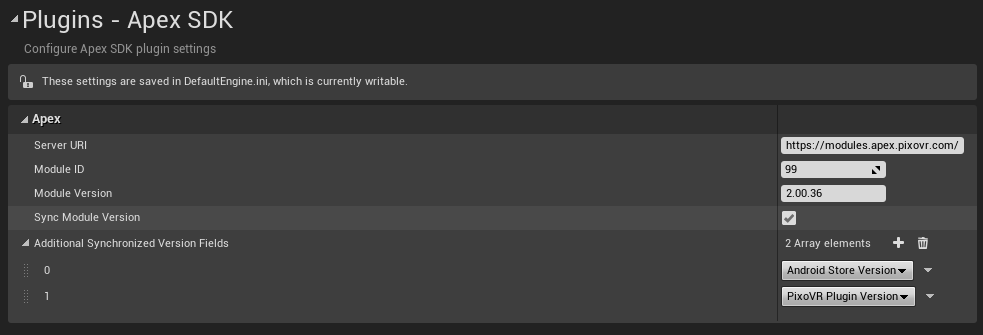

\page getting_started Installation and Overview

## Adding the Unreal Apex SDK to your Unreal project.

Your Unreal project must be a C++ project in order for this plugin to compile and work.
If your project is Blueprint Only, please convert it to a C++ Project.

To add the Unreal Apex SDK follow these steps.

1. Download the Unreal Apex SDK zip file.
2. In your Unreal project folder, add a Plugins folder if one does not already exist.
3. In the Plugins folder, copy the Unreal Apex SDK zip file.
4. Unzip the Unreal Apex SDK into a folder called UnrealApexSDK.
5. Back in the project folder, right-click on your .uproject file and **"Generate Visual Studio project Files."**
6. Launch into the editor and follow the steps below to configure your project settings.

## Configuring the Apex SDK

After installing the Unreal Apex SDK, open the Unreal Engine editor.
Open your project's **Project Settings**, scroll down to Plugins and select the Apex SDK settings category.

The following properties will need to be set in these settings.
- Server IP
  + This is the Apex server IP address that you want to send the information to. By default it will point to our production environment.
  + Use https://modules.apex.pixovr.com/.
- Module ID
  + This is the ID of the module that will be distributed to customers. This will be generated when you create a project on the Apex platform. This must be set for the data to be reported to the proper module.
- Module Version
  + The version number for your module currently being distributed.
  + The Module Version is based on Semantic numbering with a Major, Minor and Patch number. Both Minor and Patch numbers are always 2 digits, using a 0 as the first value when the number is below 10. (e.g.) 1.03.08. This is enforced on the platform itself as well.

The following properties are optional settings that can help with synchronizing information across the project.

- Sync Module Version
  + This checkbox, when ticked, will change the Unreal Project's version number to match the Module Version.
- Additional Synchronized Version Fields
  + These settings only take affects if **Sync Module Version** is ticked.
  + Android Store Version
    - This will change the **Store Version** and **Version Display Name** found under the **Platform - Android** settings.
  + PixoVR Plugin Version
    - This will change **The Version of the Module** setting found under the **Plugins - PixoVR** settings.
    - This plugin is for internal use only.

## Understanding xAPI

Data sent to Apex is formatted using the xAPI Standard. The Unreal Apex SDK utilizes a custom implementation of the xAPI standard.

To get a better understanding of the xAPI Standard, visit the <a href='https://github.com/adlnet/xAPI-Spec/blob/master/xAPI-Data.md#parttwo'>xAPI Spec</a>.

